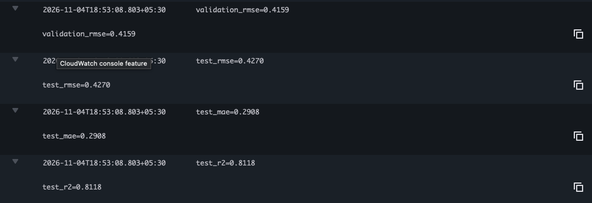
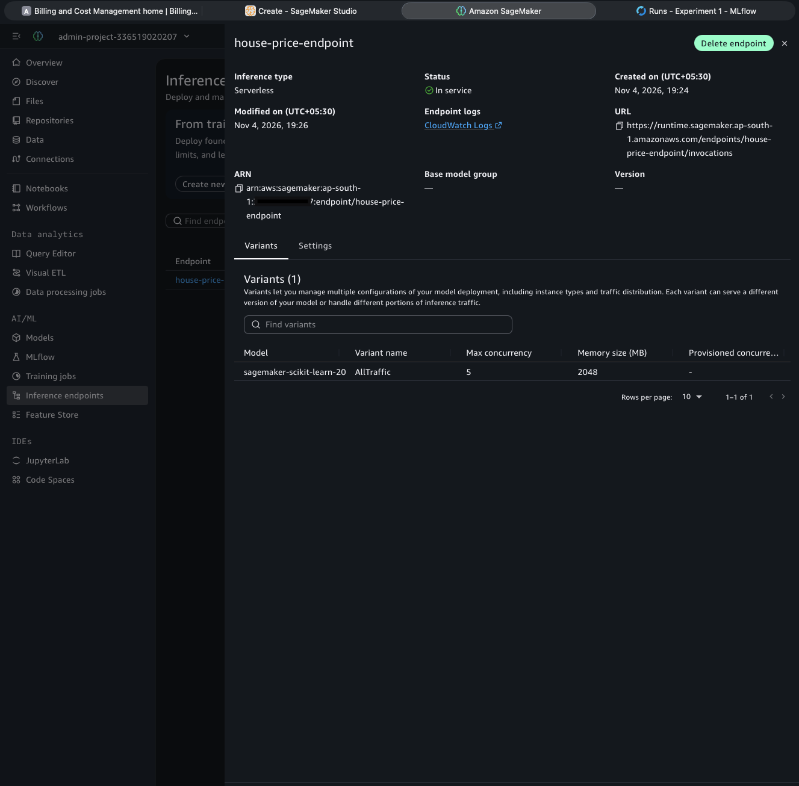
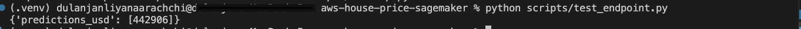
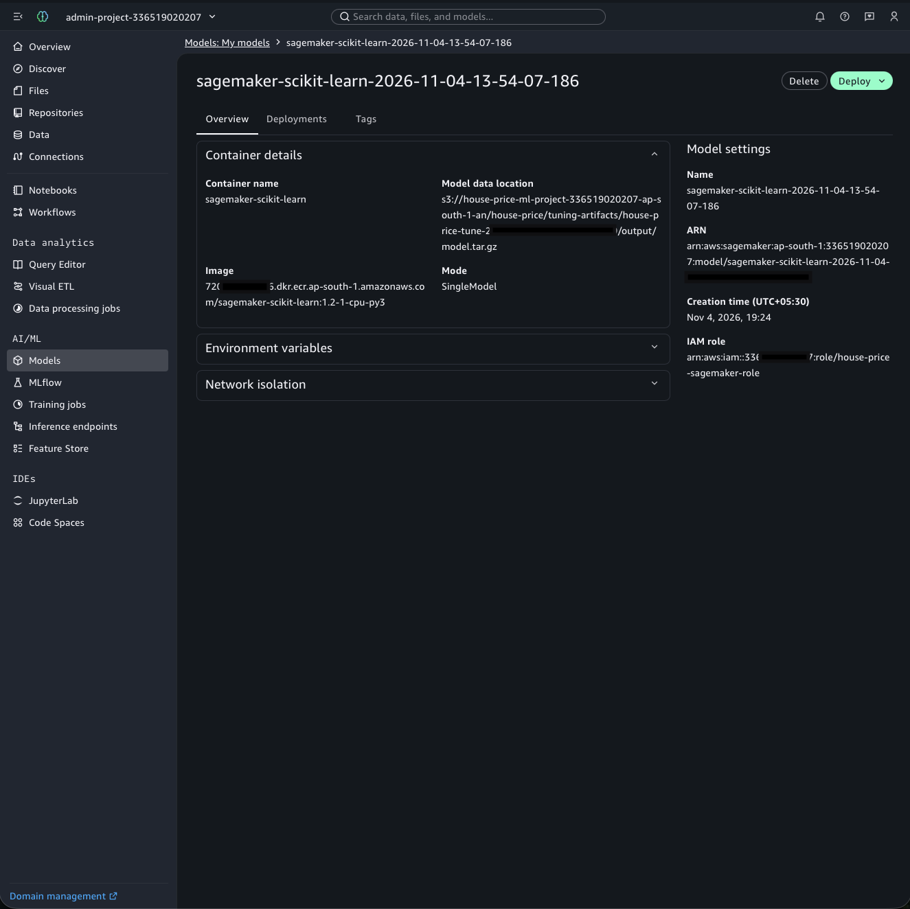
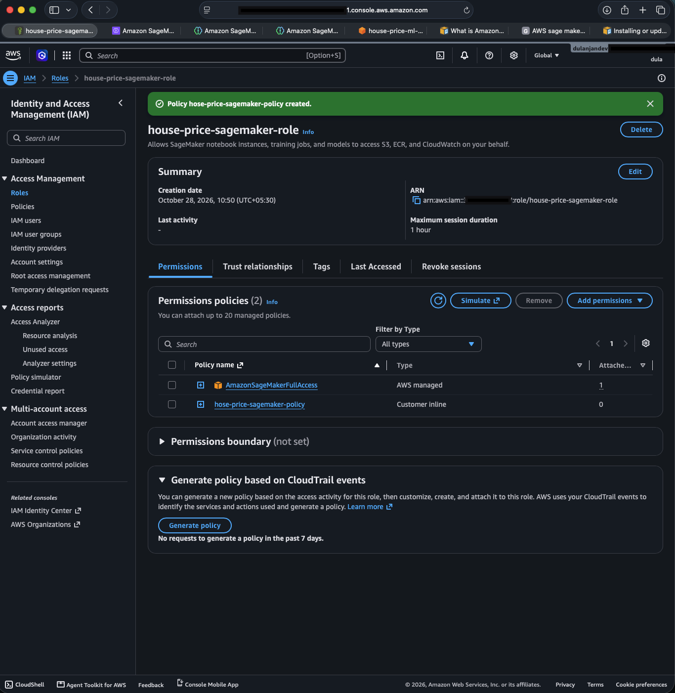
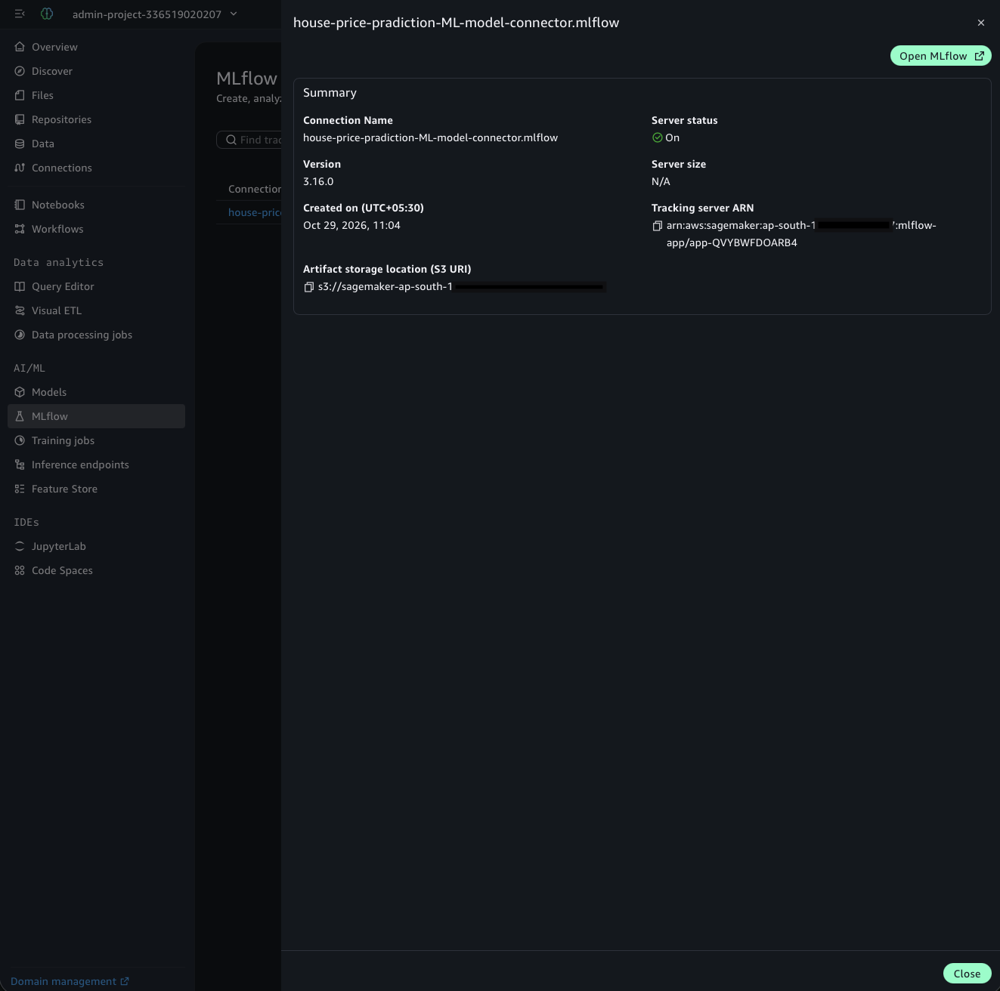
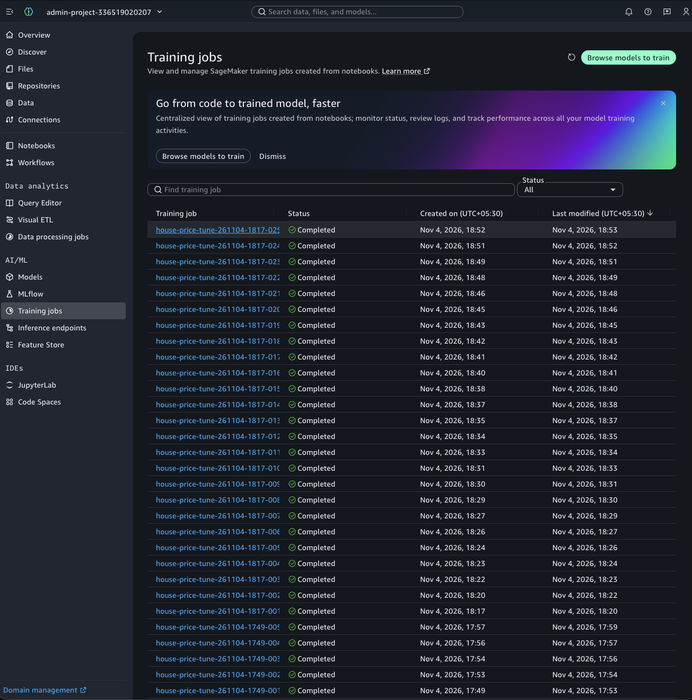

# House Price Prediction on AWS SageMaker

End-to-end machine learning project: raw data in **S3** is cleaned by a SageMaker
**Processing job**, a model is trained by a SageMaker **Training job**, deployed to a
**real-time endpoint**.
All code lives in Git; S3 holds data and model artifacts.

## Architecture

```
laptop / Studio --git push--> GitHub
      |
      | scripts/*.py (boto3 + SageMaker SDK)
      v
S3 raw data --> Processing job --> S3 processed --> Training job --> S3 model.tar.gz
(preprocessing.py)                                 (train.py)             |
                                                                          v
                                                               SageMaker Endpoint (inference.py)
```

| Piece | Service | Code |
|---|---|---|
| Data and model storage | S3 | `scripts/upload_data.py` |
| Cleaning, features, split | SageMaker Processing | `src/preprocessing.py` |
| Model training | SageMaker Training | `src/train.py` |
| Serving | SageMaker Endpoint | `src/inference.py`, `scripts/deploy.py` |


## Results


| Metric (test set) | Value |
|---|---|
| RMSE (in $100k) | 0.4270 |
| MAE (in $100k) | 0.2908 |
| R2 | 0.8118 |


Training results screenshot in cloudWatch



Model endpoint details


Model sample pradiction


Other Screenshots of the Project






## Setup

1. **AWS account**: create an S3 bucket and a SageMaker execution role (IAM) with
   `AmazonSageMakerFullAccess` plus access to your bucket. Use an IAM user or SSO, never root keys.
2. **Local environment** (or run inside SageMaker Studio):
   ```bash
   python -m venv .venv && source .venv/bin/activate
   pip install -r requirements.txt
   aws configure            # skip inside Studio
   cp .env.example .env     # then edit the values
   ```
3. **Check the code works offline**: `pip install -r requirements-dev.txt && pytest`

## Run the pipeline

```bash
python scripts/upload_data.py        # 1. dataset -> S3
python scripts/run_processing.py     # 2. Processing job
python scripts/run_training.py       # 3. Training job (saves model to S3)
python scripts/deploy.py             # 4. endpoint (add --serverless for a cheaper demo)
```

Example request body (raw features only; feature engineering happens in the endpoint):

```json
{"instances": [{"MedInc": 8.3252, "HouseAge": 41, "AveRooms": 6.98, "AveBedrms": 1.02,
                "Population": 322, "AveOccup": 2.56, "Latitude": 37.88, "Longitude": -122.23}]}
```


